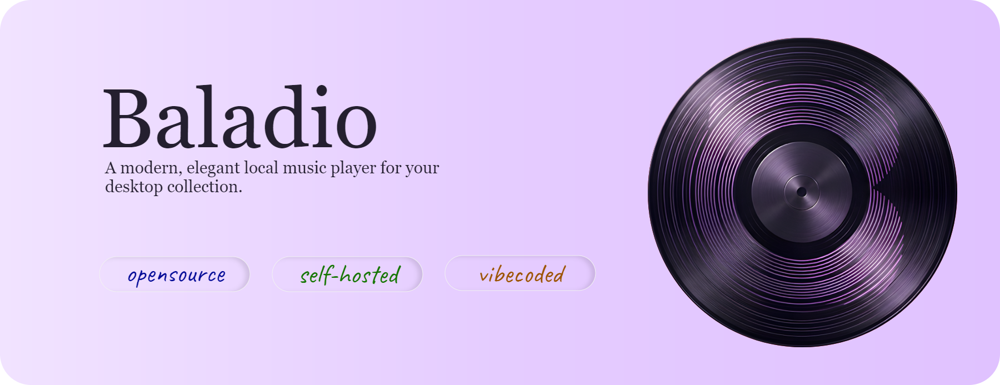

<div align="center">



# Baladio
In French, *baladeur* is a noun that means a personal stereo, portable music player, or walkman. `Baladio` is a combination of "baladeur" and "audio". Pronunciation: **bah-LAH-dee-oh.**

**A self-hosted, privacy-first desktop music player with a glassmorphism UI, spatial 8D audio, and listening analytics.**


[Features](#features) · [Getting Started](#getting-started) · [Screenshots](#screenshots) · [Keyboard Shortcuts](#keyboard-shortcuts) · [Project Structure](#project-structure) · [License](#license)

</div>

**Product Page**: [Visit Baladio's product page](https://rxdwan.github.io/baladio-product-page)

> [!TIP]
> **Prebuilt Binaries Available:** You can download ready-to-run desktop packages directly from the **[Releases](https://github.com/rxdwan/baladio/releases)** page (Windows `.exe` installer, macOS `.dmg`, and Linux `.AppImage`).

<div align="center">

<a href="https://github.com/rxdwan/baladio/releases/latest" target="_blank">
  
</a>

</div>

>★ Please star this repo and support this project as I've worked really hard for it! Thank you 🫶.

---

## Features

- **Local-First & Privacy-Focused** - plays audio files directly from your machine. No mandatory accounts, no cloud streaming, no telemetry tracking.
- **Spatial 8D Audio** - HRTF-based binaural panning using the Web Audio API. Smooth spatial rotation continues seamlessly in the background without timer throttling.
- **Studio Reverb & DSP Effects** - convolution reverb with dual Room/Plate modes, Gaussian early reflections, pitch-shifted bass boost, and custom playback speeds (0.5× to 2.0×).
- **Listening Analytics** - home dashboard tracking top songs, top artists, hottest playlists, daily play counts, artists explored, and day streaks.
- **Synced Lyrics** - real-time synchronized lyrics fetched silently via [LRCLIB](https://lrclib.net/) with scrolling karaoke fullscreen mode, manual candidate matching, and custom `.lrc`/`.txt` file uploads.
- **Smart Metadata & Cover Art** - reads embedded ID3 tags, extracts MP4 first-frame thumbnails, automatically fetches high-res iTunes art, and supports custom user uploads with disk renaming (`{Artist} - {Title}.ext`).
- **Export with Effects** - exports any track with your active effect chain (8D, reverb, speed) applied into an MP3 file via `OfflineAudioContext`.

---

## Getting Started

### Option 1: Download Prebuilt Desktop App (Recommended)

Grab the latest release package for your operating system from the **[Releases](https://github.com/rxdwan/baladio/releases)** page:

* **Windows**: Download `Baladio-win-3.0.0.exe` (NSIS installer).
* **macOS**: Download `Baladio-mac-3.0.0.dmg` (drag to Applications) or `.zip`.
* **Linux**: Download `Baladio-linux-3.0.0.AppImage` (`chmod +x` and run) or `.deb`.

> **Note:** On first run, Baladio automatically sets up your local SQLite database and downloads the latest `yt-dlp` YouTube streaming engine. No Python or manual command-line setups are required!

---

### Option 2: Running from Source (Developers)

#### 1. Clone the repository
```bash
git clone https://github.com/rxdwan/baladio.git
cd baladio
```

#### 2. Install dependencies
```bash
npm install
```

#### 3. Run Baladio Desktop
```bash
npm run electron
```

---

### Adding Your Music

Place your music files (`.mp3`, `.m4a`, `.flac`, `.wav`, or `.ogg`) in a `songs/` folder **one level above** `Baladio/`:

```
your-music-directory/
├── songs/               ← drop your audio files here
│   ├── track1.mp3
│   ├── track2.flac
│   └── track3.m4a
└── Baladio/             ← this repository
```

> **Tip:** You can quickly open your local songs folder at any time directly from Baladio using the shortcut `Ctrl + Shift + O` (or `Cmd + Shift + O` on macOS).

---

### Building Packages Locally

To compile standalone desktop binaries on your machine:

```bash
npm run electron:build:win    # Windows NSIS installer (.exe)
npm run electron:build:mac    # macOS .dmg & .zip
npm run electron:build:linux  # Linux .AppImage & .deb
```

---

## Keyboard Shortcuts

| Key | Action |
|-----|--------|
| `Space` | Play / Pause |
| `F` | Toggle fullscreen view |
| `L` | Toggle lyrics (fullscreen view) |
| `M` | Mute / Unmute audio |
| `Esc` | Navigate back / Close active overlay |
| `→` | Seek 5 seconds forward |
| `←` | Seek 5 seconds backward |
| `Shift` + `→` | Next track |
| `Shift` + `←` | Previous track |
| `Ctrl` + `Shift` + `O` | Open local songs folder in File Explorer / Finder |

---

## Acknowledgements

Built with:
- [Electron](https://www.electronjs.org/) - Cross-platform desktop framework
- [Express.js](https://expressjs.com/) - Node.js local streaming backend
- [better-sqlite3](https://github.com/WiseLibs/better-sqlite3) - High-performance local SQLite database
- [yt-dlp](https://github.com/yt-dlp/yt-dlp) - YouTube audio download engine
- [LRCLIB](https://lrclib.net/) - Free, open-source synced lyrics API
- [music-metadata](https://github.com/borewit/music-metadata) - Audio tag parsing
- [node-id3](https://github.com/Zazama/node-id3) - MP3 ID3 tag writing
- [fluent-ffmpeg](https://github.com/fluent-ffmpeg/node-fluent-ffmpeg) - MP4 thumbnail extraction
- Web Audio API - 8D spatial audio, convolution reverb, and offline rendering

---

>★ Please star this repo and support this project as I've worked really hard for it! Thank you 🫶.

## License

[](https://www.gnu.org/licenses/gpl-3.0)
This project is licensed under the GNU General Public License v3.0 (GPLv3). See the [LICENSE](LICENSE) file for details.